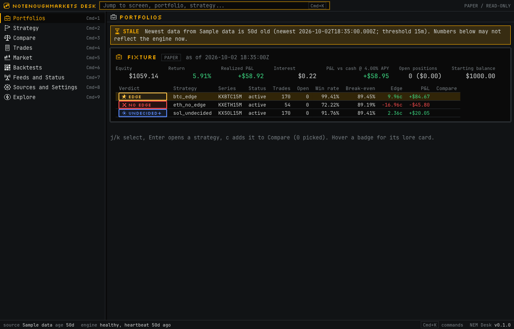
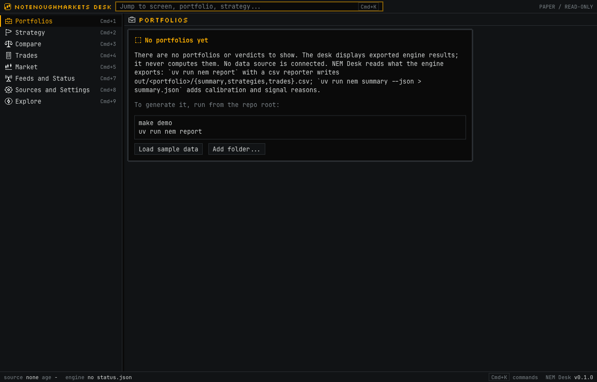
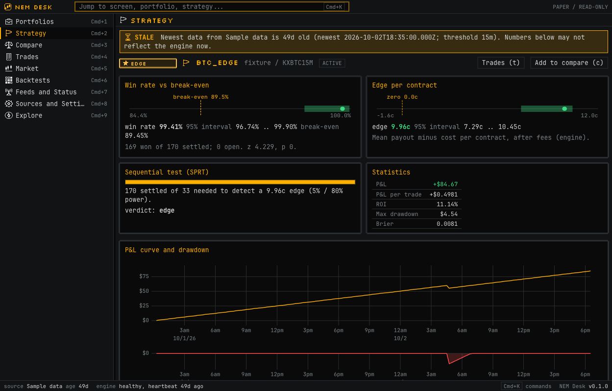
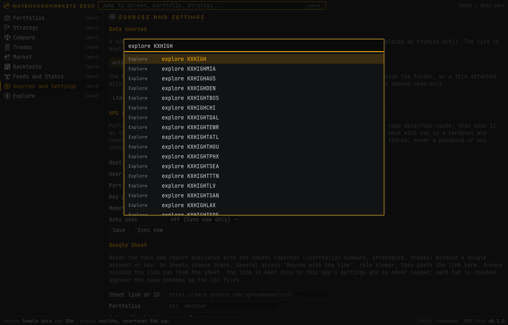
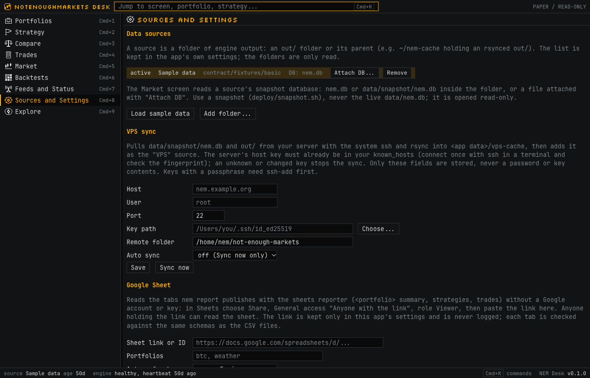
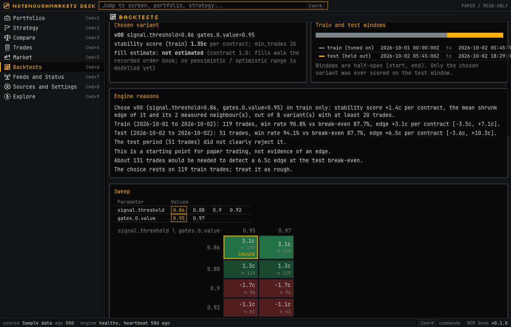
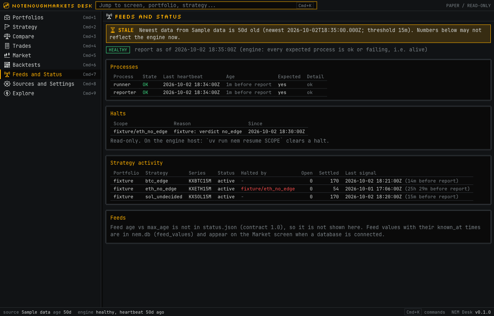
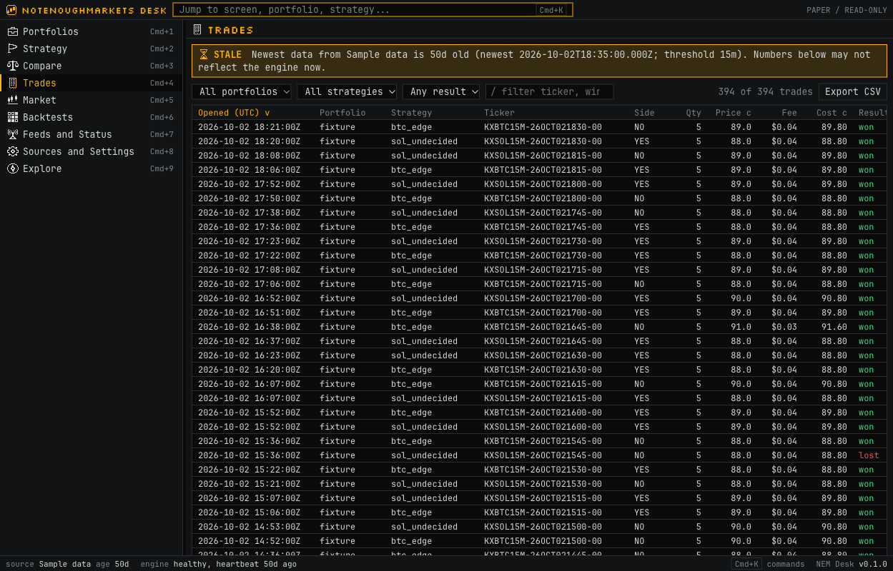
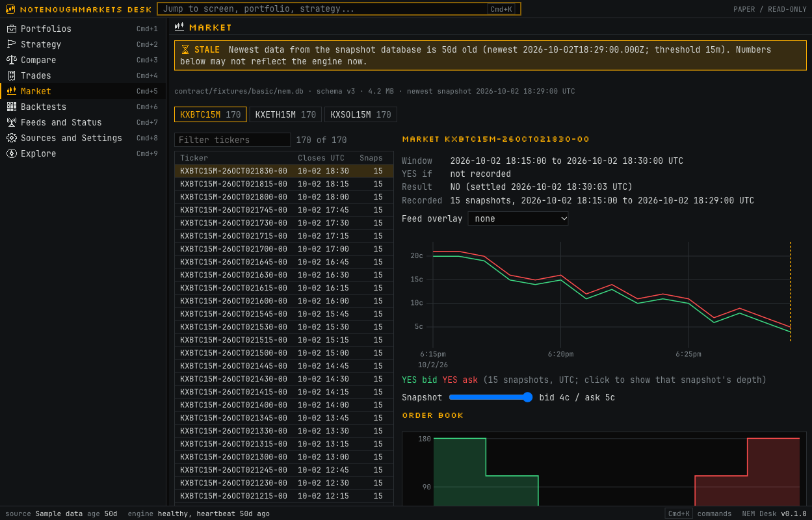
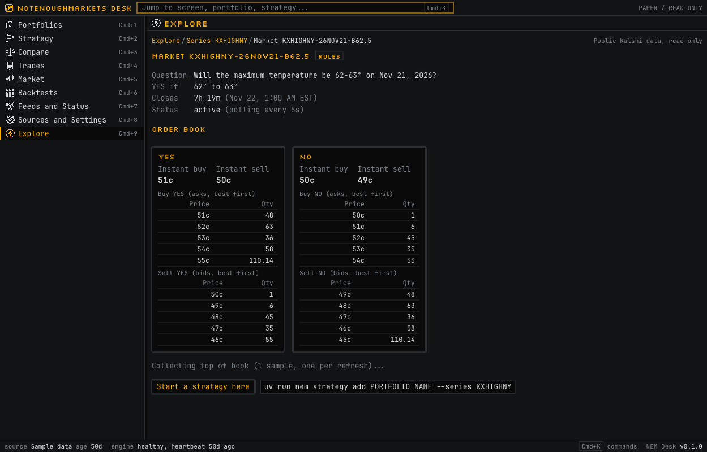

# NotEnoughMarkets (NEM)

[](https://github.com/ahanqiliu903/not-enough-markets/actions/workflows/ci.yml)


[](LICENSE)

A template for Kalshi algorithmic trading.

<sub>Name inspired by Moulberry's [NotEnoughUpdates](https://github.com/Moulberry/NotEnoughUpdates) for Hypixel Skyblock.</sub>

> [!WARNING]
> **This is NOT a trading strategy, and it will NOT guarantee you any profits.**
> It is meant to be an all-in-one home for automated prediction market trading.

> [!NOTE]
> **Beta.** You can record live Kalshi data, paper-trade on it with external feeds, get statistics and CSV/Google Sheets reports, run it 24/7 on a server, and browse everything in the **NEM Desk** desktop app today. Live trading is still to come. See [Roadmap](#roadmap).



**Contents:** [Tutorial](#tutorial) · [How it's organized](#how-its-organized) · [Reading the statistics](#reading-the-statistics) · [Reports](#reports-csv-json-google-sheets) · [Running 24/7](#running-247) · [NEM Desk](#nem-desk) · [Roadmap](#roadmap)

## What is this for?

Say you have a hypothesis:

> *Is Kalshi's 15-min BTC Up/Down market overpricing contracts in the 90c+ price range?*

How do you test it? Given the constraints of the strategy, a coding agent (Claude Code, Codex, Cursor, ...; see [AGENTS.md](AGENTS.md)) takes in inputs about the strategy you want to test (which market, price range, how often, etc.) and turns them into a testable paper trading system, with automated market and portfolio data ingestion and analysis.

- **No new infrastructure every time.** Reuse the same engine for every idea.
- **Common parameters** (stricter entry, timing, sizing) so you can tweak your strategy as you go.
- **Easy comparison** of your current strategies against previous ones.

## Tutorial

From nothing to a paper-trading strategy you can watch in a desktop app. No Kalshi account is needed for any of it.

### 1. Install and run the demo

You need `git`, `make` and [uv](https://docs.astral.sh/uv/) (`curl -LsSf https://astral.sh/uv/install.sh | sh`); uv installs the right Python by itself.

```bash
git clone https://github.com/ahanqiliu903/not-enough-markets.git && cd not-enough-markets
make setup                 # install dependencies
make demo                  # replay ~2h of bundled BTC/ETH data through examples/portfolios/
```

The demo prints a statistics block per strategy (see [Reading the statistics](#reading-the-statistics)).

### 2. Open NEM Desk

NEM Desk is a read-only desktop app for everything the engine exports. Build and start it (Node 24; prebuilt downloads aren't published yet):

```bash
cd apps/desk && npm ci && npm run dev
```

On first launch there's no data yet. **Load sample data** opens a bundled example; **Add folder...** points it at your own `out/` folder (step 5).



### 3. Read a strategy

Each portfolio card lists its strategies with a verdict badge: **edge**, **no edge** or **undecided**. Open one (click, or `j`/`k` then Enter) to see win rate vs break-even, edge per contract, how far the sequential test has come, and the P&L curve.



The question is always *win rate vs break-even after fees*. A strategy at 99% wins can still lose money if it pays 99.5c per contract. [Reading the statistics](#reading-the-statistics) explains every number.

### 4. Paper-trade your own idea

Find a market first. Explore (`Cmd/Ctrl+9`, or type `explore` in the command palette, `Cmd/Ctrl+K`) browses Kalshi's public markets with their order books and settlement rules. [docs/kalshi-tickers.txt](docs/kalshi-tickers.txt) lists common series too. Always read a market's rules before trading it.



Then, from the repo root:

```bash
uv run nem init                                          # first portfolio (asks name + balance)
uv run nem strategy add paper fav90 --series KXBTC15M    # appends a template; edit it in portfolios/paper.yaml
uv run nem validate                                      # checks every file and plugin
uv run nem run                                           # paper-trade on live Kalshi prices, recording as it goes
```

Working with a coding agent? Point it at [AGENTS.md](AGENTS.md): it turns a plain-English hypothesis into a portfolio file, reads the settlement rules back to you, and shows the break-even math before anything trades.

`uv run nem help` lists every command with its options; `uv run nem help run` shows one in detail. More: `nem portfolio new|list|show`, `nem replay --data data/nem.db` to run portfolios over recorded data, `nem export` to save recordings as a portable file.

Compare against your own manual trading: `nem import kalshi-pnl` loads Kalshi's realized-PnL export as a read-only `manual_baseline` portfolio that `nem summary` reports next to the others ([docs/data-provenance.md](docs/data-provenance.md)).

### 5. Watch it in the desk

```bash
uv run nem report --every 5m       # writes out/<portfolio>/*.csv plus out/summary.json and out/status.json
```

In NEM Desk, **Sources and Settings** (`Cmd/Ctrl+8`) → **Add folder...** → pick `out/` (or the repo root). The desk refreshes as the files change. Running on a server? The same screen syncs `out/` over SSH, or reads the published Google Sheet.



### 6. Get suggested settings, once there's data

After weeks (not hours) of recording, sweep a few settings of a strategy:

```bash
uv run nem suggest paper fav90 --data data/nem.db \
  --grid signal.threshold=0.86,0.88,0.90,0.92 --grid gates.0.value=0.94,0.96,0.98 --save
```

- Each `--grid` is a setting (a dotted path into the strategy, list items by position) and the values to try. Keep it to one or two settings with a handful of values.
- The data is split in time: settings are chosen on the earliest 70% (`--holdout 0.3`) and only checked on the rest, never chosen from it.
- The choice favors a broad region of decent settings over the single best cell, shrinks small samples toward zero edge, and treats variants with fewer than `--min-trades` (30) trades as unknown.
- The result is `suggested`, `rejected` (nothing looked profitable, or it clearly lost on the later data) or `insufficient` (not enough trades). It prints a train vs test table and the grid.
- `--write` appends the suggestion as `<strategy>_suggested` to the portfolio file, next to the original, so both paper-trade side by side. `--save` keeps the run for the desk's **Backtests** screen:



### 7. Keep it running

Put it on a small server ([Running 24/7](#running-247)) and check on it from **Feeds and Status** (`Cmd/Ctrl+7`): process heartbeats, halts and what each strategy has been doing.



"Undecided after 40 trades" is the expected answer for weeks. Near 90c, telling a 2c edge from none takes over a thousand trades.

## How it's organized

```
portfolios/
├── btc_research.yaml     # paper portfolio, $1,000 virtual balance
│   ├── fav90             #   strategy: BTC 15m, buy favorite at 90c+
│   └── fav85             #   strategy: same idea, 85c+ threshold
└── live_small.yaml       # live portfolio, $50 budget
    └── fav90_live
```

- **Portfolio**: one YAML file and one pool of capital. It's either **paper** (virtual starting balance) or **live** (a budget carved out of your real Kalshi balance), never both, so its P&L always means something. Portfolio-level risk limits apply across all its strategies, and its **feeds** are shared by all of them.
- **Strategy**: one market series, checked on its own schedule (`check_every`, from seconds to minutes), plus four pluggable parts:

| Part | Decides | Examples |
|---|---|---|
| **signal** | When to enter, which side, at what price. Can read feeds. | `extreme_favorite` (buy the favorite at 90c+) |
| **gates** | Whether to veto a trade the signal wants. Can read feeds. | `max_entry_price`, `time_in_window` (only the last N minutes), `city_filter` (allow/exclude weather cities by station), `strike_filter` (only some strike types, e.g. `between` = the inner brackets), `market_day_window` (enter only between local times anchored on the market date, e.g. 06:00 to noon on the day), "skip if forecast precipitation > 60%", forecast gates for temperature markets: `source_agreement` (>= N forecast sources on our side of the strike), `bracket_distance` (forecast >= D degrees from where our side loses), `sky_conditions` (veto on rain chance / cloud cover); see [examples/weather/](examples/weather/forecast_gates.yaml) |
| **sizing** | How many contracts. | `fixed` (N contracts), `percent` (N% of the portfolio), `kelly` (fractional, always with a contract cap) |
| **risk** | Hard limits, checked against the order's full cost including the entry fee. Always fail closed. | `max_allocation`, `max_city_allocation` (open cost per weather station, see [examples/risk/](examples/risk/city_caps.yaml)), `daily_loss_cap`, `max_drawdown`, `max_open_positions`, kill rule ("pause if win rate < break-even after N trades") |

Strategies can be `active`, `paused` or `retired`. Retired ones keep their history so you can compare old ideas against new ones.

- **Feeds** (external data): anything a market depends on besides its own prices, e.g. a crypto spot price, a commodity price, or a temperature forecast. Every market targets something different, so feeds are plugins too: write one small class per data source and any signal or gate can use it by name.
  - Feed values are **recorded with timestamps**, like market data, so replay sees only what was known at the time. Forecasts also record when they were **issued**, so a backtest can't use a forecast published after the trade.
  - Each feed has a `max_age`. Older data counts as unavailable, and each gate declares whether it then lets trades through or blocks them.
  - Built in: `coinbase_spot` (crypto spot price), `nws_forecast` (US daily high/low and precipitation chance from the National Weather Service), and model forecasts per weather station for the forecast gates: `iem_mos` (GFS MOS and NBM text, public domain) and `open_meteo_run` (raw ECMWF, Canadian GEM, DWD ICON runs; Open-Meteo's free tier is non-commercial only, so it is opt-in). Sources, terms and independence: [docs/data-provenance.md](docs/data-provenance.md#live-model-forecast-feeds-iem_mos-open_meteo_run). Gates that use them: `feed_agrees` (the feed value is on the bet's side of the market's strike, with a margin) and `feed_threshold` (veto outside a range, e.g. precipitation over 60%). See [examples/feeds/](examples/feeds/feeds_example.yaml).
  - Feeds are predictors, not settlement sources. Kalshi decides every outcome; check each market's rules for what it actually settles on (e.g. temperature markets settle on The Weather Company, not NWS).

Example portfolio file:

```yaml
name: btc_research
mode: paper
starting_balance: 1000
interest_apy: 0.0325             # Kalshi's current rate; it changes, so check it. null = off
check_every: 5s                  # default for every strategy below
max_snapshot_age: 2m             # never enter on a market snapshot older than this (default 2m)
risk: {daily_loss_cap: null, max_open_positions: 3}   # null = disabled
fills: {missing_depth: none}     # no recorded depth = no fill (default); see docs/exits-and-fills.md

feeds:
  - {name: btc_spot, type: coinbase_spot, product: BTC-USD, every: 5s, max_age: 30s}

strategies:
  - name: fav90
    series: KXBTC15M
    signal: {type: extreme_favorite, threshold: 0.90, min_edge: 0.015}
    gates:
      - {type: max_entry_price, value: 0.95}
      - {type: time_in_window, last_minutes: 5}
    sizing: {type: fixed, contracts: 5}
    risk: {max_allocation: 200, max_open_positions: 1}

  - name: fav85_spot
    series: KXBTC15M
    check_every: 2m                # per-strategy override
    signal: {type: extreme_favorite, threshold: 0.85, min_edge: 0.015}
    gates:
      - {type: feed_agrees, feed: btc_spot, margin_pct: 0.05}   # veto unless spot is already on the bet's side of the target price
    sizing: {type: kelly, fraction: 0.25, max_contracts: 10}
```

Positions are held to settlement for now. Exits before settlement (stop-loss, take-profit) are planned as a later plugin kind.

## Workflow

1. Write the strategy hypothesis in plain English.
2. Fit its constraints into a portfolio YAML config.
3. Set up the required data pipelines.
   - If data needs to be collected before backtesting, set up logging and schedules to do so.
4. Run a backtest (**not** a validation): `nem replay`.
5. For strategies that weren't rejected, get suggested starting settings (e.g. entry threshold, time in window, sizing): `nem suggest`.
   - A small parameter sweep over recorded data, tuned on one period and checked on a later one it never saw.
   - Suggests the middle of a stable region of good settings rather than the single best point, and shows sample sizes, so you don't start paper trading on a lucky fit.
6. Run paper trading with those settings.
7. *(Optional)* Deploy live.

### Hot take: I hate backtests

Especially nowadays, it's very easy for them to give optimistic results. The workflow includes a backtest only to reject strategies that show clearly negative results, and the suggested settings are just a sensible starting point. Paper trading is a better indicator.

## Reading the statistics

`nem summary` (and `make demo`) print this for every strategy:

```
  fav90_any  KXBTC15M  active  5 trades (4 won), 0 open
    win rate    80.0% [37.6%, 96.4%]   break-even 91.2%   z -0.88 (p 0.81)
    edge        -11.2c per contract [-53.6c, +5.2c]
    P&L         -2.79  (-0.56/trade, ROI -12.3%)   max drawdown 4.58
    verdict     undecided after 5 trades; ~1,152 trades to detect a 2.0c edge
    calibration Brier 0.177  92%-94%: said 93.1%, won 80.0% (n=5)
```

- **win rate**: with a 95% confidence interval (Wilson), so a lucky streak doesn't look like skill.
- **break-even**: every trade pays price + fees to win $1, so it breaks even at a win rate equal to its cost per contract. The question is always *win rate vs break-even*.
- **z / p**: how surprising the wins are if the strategy has no edge (each trade winning exactly as often as its price implies).
- **edge**: average profit per contract, with its interval.
- **verdict**: a sequential test (SPRT) checked after every trade. It says *edge*, *no edge* or *undecided*, plus roughly how many trades it takes to detect an edge of that size. Near 90c, telling a 2c edge from none takes over a thousand trades, which is why paper trading takes patience.
- **calibration**: does the signal's estimated win probability match reality? Brier score: lower is better.
- Portfolios with `interest_apy` also show **P&L vs simply holding cash** at Kalshi's rate.

Tune the test with `--edge 0.03`, `--alpha`, `--power`.

### Excluding a trade

A trade that shouldn't count as evidence (a bug, a test order, a fill at a bad recorded
price) can be excluded without deleting it:

```bash
uv run nem trade exclude KXBTC15M-26OCT071530-30 --reason "fill at a stale price"  # --portfolio/--strategy if ambiguous
uv run nem trade list --excluded                # every excluded trade, why and when
uv run nem trade include KXBTC15M-26OCT071530-30  # undo
```

An excluded trade is treated as **never taken**. It leaves every statistic (win rate, edge,
intervals, verdict, trades to detect, calibration, the strategy's P&L/ROI/drawdown, the
`stop_if_losing_after` kill rule, what signals and gates see via `ctx.settled_trades()` and
`ctx.stat()`) and the money too: realized P&L, equity, cash, open positions, marks and every
risk limit (`daily_loss_cap`, `max_drawdown`, allocation and position caps). An excluded
open trade frees its slot and its cash. Reports still list it (`excluded`, `exclude_reason`
in trades; `excluded_trades` counts) and `nem summary` says "N excluded (M settled, P&L x
not counted)". Exclude for a reason you'd state up front, never to improve a verdict.

## Reports (CSV, JSON, Google Sheets)

**Sample:** [live paper-trading report](https://docs.google.com/spreadsheets/d/1ky1-ilFsvnDLwWVcjeTkvoWh3sUKh4DMgYDnd9wsVy8/edit?usp=sharing)
(Google Sheets, view only, updated every 5 minutes from a NEM server).

Reporting runs as its own process, so reports keep flowing even when no strategy is running:

```bash
uv run nem report                 # print and publish once
uv run nem report --every 5m      # keep publishing
```

Every `nem report` also writes `summary.json` and `status.json` into `out/` (`--json-dir` to change it), which NEM Desk reads alongside the CSVs.

Each portfolio chooses where its reports go, with a top-level `reporting:` list in its
file in `portfolios/` (next to `starting_balance`, not inside `strategies:`):

```yaml
reporting:
  - {type: csv, path: out}                       # out/<portfolio>/{summary,strategies,trades}.csv
  - {type: sheets, sheet_id_env: SHEET_ID}       # tabs "<portfolio> summary|strategies|trades"
```

Google Sheets setup: `uv sync --extra sheets`, create a Google Cloud service account with a JSON key, share the spreadsheet with the service account's email, then set `SHEETS_CREDENTIALS=/path/to/key.json` and `SHEET_ID=<spreadsheet id>` in the environment (never in the YAML). Several portfolios can share one spreadsheet; each writes only its own tabs.

## Recording market data

`nem run` already records every market its strategies trade. Use `nem record` (or `nem run --record-series`) to collect data for series you aren't trading yet. Recording takes calendar time, so start early. No Kalshi account needed: public market data doesn't require an API key.

```bash
uv run nem record --series KXBTC15M --series KXETH15M        # poll every 5s, forever
uv run nem record --series KXBTC15M --interval 10 --depth 20  # slower, deeper orderbook
uv run nem record --series KXBTC15M --once                    # single poll, then exit
```

Each poll stores every open market's top of book and orderbook depth to `data/nem.db` (SQLite). Once a market closes, the recorder fetches its result, so recorded data can later be replayed and settled. Network errors are logged and retried on the next poll.

## Running 24/7

[deploy/RUNBOOK.md](deploy/RUNBOOK.md) sets up a small Linux server (e.g. the cheapest DigitalOcean droplet) with two systemd services: `nem-run` (paper trading + recording, all portfolios in one ~50 MB process) and `nem-report` (reports every 5 minutes).

```bash
nem status                                      # process health, halts, per-strategy activity
nem halt research/fav90 --reason "check fills"  # kill switch: everything, a portfolio, or one strategy
nem resume research/fav90
```

Edit portfolio files while it runs: changes are picked up on the next tick, and an invalid edit is rejected while the old config keeps running.

## NEM Desk

A desktop app (macOS, Windows) for looking at what the engine exports. It's read-only apart from an opt-in halt/resume over SSH: it never computes statistics, places orders or holds Kalshi keys.

| Key | Screen | What it shows |
|---|---|---|
| Cmd/Ctrl+1 | Portfolios | Equity, P&L vs holding cash, strategies with verdict badges |
| Cmd/Ctrl+2 | Strategy | Win rate and edge intervals vs break-even, sequential test, P&L and drawdown, calibration, signal reasons |
| Cmd/Ctrl+3 | Compare | 2 to 4 strategies (retired included) side by side |
| Cmd/Ctrl+4 | Trades | Sortable, filterable blotter with CSV export |
| Cmd/Ctrl+5 | Market | Recorded markets: top of book, depth, feed values at the time they were known |
| Cmd/Ctrl+6 | Backtests | `nem suggest` sweeps: heatmap, chosen cell, train vs held-out test |
| Cmd/Ctrl+7 | Feeds and Status | Engine health, heartbeats, halts |
| Cmd/Ctrl+8 | Sources and Settings | Folders, VPS sync, Google Sheet, display options, diagnostics |
| Cmd/Ctrl+9 | Explore | Kalshi's public markets, order books and settlement rules |

| Trades | Market | Explore |
|---|---|---|
|  |  |  |

- **Sources:** a local `out/` folder, a server synced over SSH (system `ssh` + `rsync`, your existing keys), or a Google Sheet shared as "Anyone with the link: Viewer". A snapshot `nem.db` next to the source feeds the Market screen.
- **Install:** build from source (`cd apps/desk && npm ci && npm run dist` for macOS `.dmg`s, `npm run dist:win` for Windows). Builds are unsigned, so each OS warns once; [apps/desk/README.md](apps/desk/README.md#install) has the first-open steps, every shortcut, and how each source works.
- **Data contract:** the engine and the desk only meet through versioned schemas in [contract/](contract/README.md) (CSV columns, JSON documents, units, timestamps), so either side can change without silently breaking the other.

## Design principles

- **Same code for backtest, paper and live.** Only the data sources (market and feeds) and the broker change, so a strategy can't behave differently in replay than it does live.
- **No look-ahead.** Signals and gates only see results that settled, and feed values that were published, *before* the current time. This is enforced in one place and tested.
- **Every signal is logged with a reason**, including the ones that were skipped, so you can measure what each gate actually did.
- **Kalshi's fees and interest are part of every number.** Paper fills charge Kalshi's taker fee (rounded up to the cent, per order) and walk the real orderbook, so entry prices include slippage. A quote without recorded depth is a price, not a size: nothing fills against it unless a portfolio opts in (`fills.missing_depth: quote`), and those results are labelled. Edge and break-even win rate are computed after fees. Paper portfolios can accrue Kalshi's interest (APY on cash and open positions, accrued daily), so a strategy has to beat simply holding cash to look good.
- **Idempotent orders.** Order IDs are deterministic, so a retry can never double-fill.
- **Fail safe.** Risk checks fail closed. Each gate declares whether it fails open or closed when its data is missing or stale; a gate that crashes (a bug) always blocks the trade. Risk limits use `null` for "disabled", never `0`.
- **Secrets only from environment variables.** Nothing secret is ever in a config file or a commit; [gitleaks](https://github.com/gitleaks/gitleaks) runs on every commit and in CI.

## Roadmap

| | Milestone | What it adds |
|---|---|---|
| ✅ | **M0 Skeleton** | Packaging (uv), lint (ruff), strict typing (pyright), tests (pytest), secret scanning, CI |
| ✅ | **M1 Core** | Portfolio/strategy config with validation, plugin registry, SQLite store, look-ahead-safe strategy context, Kalshi window-code math |
| ✅ | **M2 Market data** | Kalshi read client and auth, `nem record` to collect market snapshots and settlements, replay from recorded data |
| ✅ | **M3 Paper trading** | The trading loop; plugin interfaces for signals, gates, sizing, risk and feeds; paper broker with Kalshi fees, realistic fills and interest accrual; `extreme_favorite`, `max_entry_price`, `time_in_window`, `fixed` / `percent` / `kelly` sizing; `nem init` / `nem portfolio` / `nem strategy` commands; `make demo` |
| ✅ | **M4 Stats & reporting** | Win rate with confidence intervals vs break-even, P&L, drawdown, "enough trades to decide yet?" test, CSV + Google Sheets reports |
| ✅ | **M5 24/7 operation** | systemd services and runbook, one process for trading + recording, config hot-reload, `nem status` / `nem halt` / `nem resume` |
| ✅ | **M6 External feeds** | Coinbase spot and NWS forecast feeds, recorded by `known_at`; market strikes recorded with snapshots; `feed_agrees` and `feed_threshold` gates |
| ✅ | **M7 Backtest & suggested settings** | `nem replay` over recorded market and feed data through the same loop; `nem suggest` sweeps a small grid in one pass, picks a stable region on the earlier data, and checks it on later data it never saw |
| ✅ | **NEM Desk** | Desktop app over the engine's exports; data contract 1.0 (versioned CSV/JSON schemas); `nem report` writes JSON for the desk |
| ⬜ | **M8 Live trading** | Live broker on Kalshi (demo first), risk manager, budgets across live portfolios |
| ⬜ | **M9 Docs** | Lessons from running live, "write a signal / feed" guides, a worked case study |

Later: exits before settlement, and deeper agent tooling (hypothesis in plain English → portfolio config).

## Development

Requires [uv](https://docs.astral.sh/uv/) and [gitleaks](https://github.com/gitleaks/gitleaks).

```bash
make setup    # install dependencies and pre-commit hooks
make check    # lint, type-check, test
make fmt      # auto-fix lint and formatting

cd apps/desk && npm ci && npm run check   # desk: lint, type-check, unit tests (Node 24)
```

## Requirements

| Requirement | Needed for |
|---|---|
| Virtual Private Server (VPS) | 24/7 data collection and paper/live trading. I personally use DigitalOcean. |
| Google Cloud service account | *Optional but recommended.* Reporting CSV data to Google Sheets. |
| Kalshi account | Live trading only. |
| Patience | Everything. |

## License

[MIT](LICENSE)
