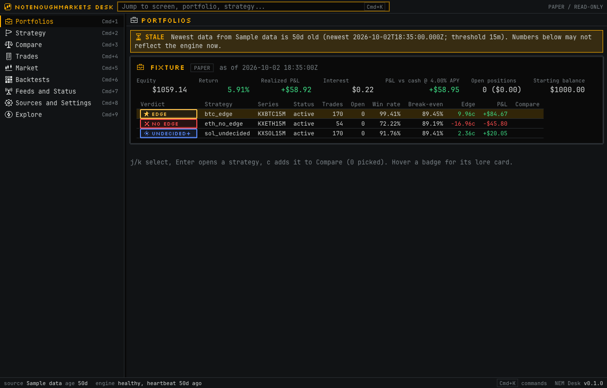
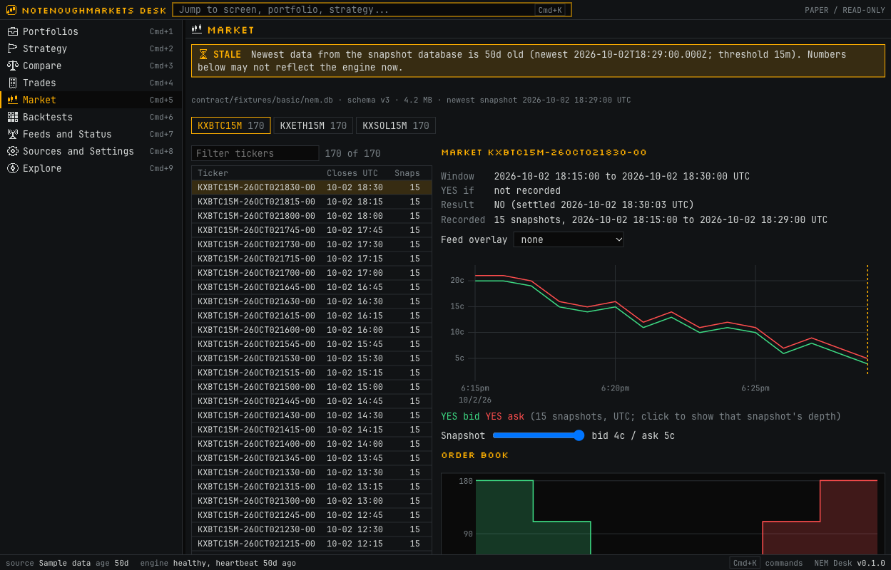
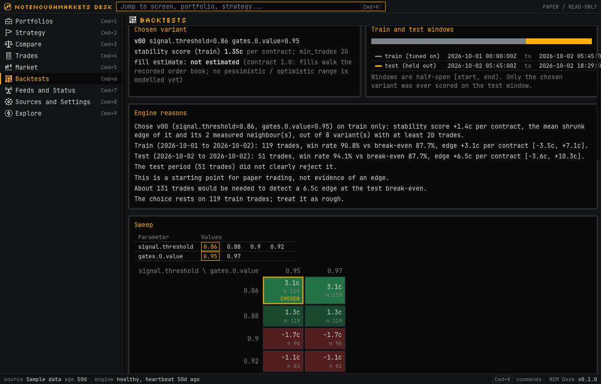
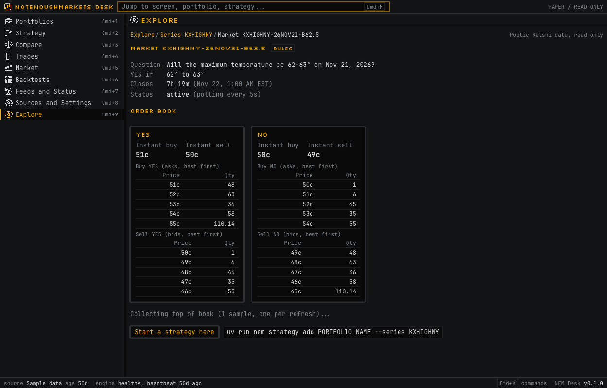

# NEM Desk

A read-only desktop app for looking at NotEnoughMarkets results: portfolios, strategy
verdicts, trades, market data and engine status. It reads files the engine exports and
never computes statistics, places orders, or holds Kalshi keys.



Status: every ticket in [TICKETS.md](TICKETS.md) is done. More screenshots (all on the
bundled sample data and recorded Kalshi responses) are in [docs/screenshots/](docs/screenshots/).

## Screens

| Key | Screen | What it shows |
|---|---|---|
| Cmd/Ctrl+1 | Portfolios | A card per portfolio (equity, P&L vs holding cash, open positions, open value and unrealized P&L), strategy rows with verdict badges; hover a badge for its lore card |
| Cmd/Ctrl+2 | Strategy | Tier badge, win-rate and edge intervals vs break-even, SPRT progress, P&L curve and drawdown, calibration, signal reasons |
| Cmd/Ctrl+3 | Compare | 2 to 4 strategies (retired included): P&L curves from a common start, stats, verdicts |
| Cmd/Ctrl+4 | Trades | Virtualized blotter: sort, filter, CSV export (100k rows smooth); each open trade's mark (unrealized P&L, mark value, bid, mid; "no bids" flag when contracts are valued at $0); trades excluded from statistics muted with their reason, "Hide excluded" toggle |
| Cmd/Ctrl+5 | Market | Recorded markets from a snapshot DB: top of book, depth, feed overlay at `known_at` |
| Cmd/Ctrl+6 | Backtests | Run list, sweep heatmap (chosen cell, `n` per cell), train vs held-out test, backtest vs paper (hidden until a source has backtests) |
| Cmd/Ctrl+7 | Feeds and Status | Engine health, heartbeats, halts, per-strategy activity |
| Cmd/Ctrl+8 | Sources and Settings | Sources, Google Sheet, VPS sync, halt/resume flag, pixel accents, font size, updates, diagnostics |
| Cmd/Ctrl+9 | Explore | Kalshi's public markets: categories, series, markets, YES/NO order book, settlement rules |

| Market | Backtests heatmap | Explore |
|---|---|---|
|  |  |  |

## Keyboard shortcuts

| Keys | Action |
|---|---|
| Cmd/Ctrl+K | Command palette: jump to a screen, portfolio, strategy or series (`explore KXHIGHNY`), switch source, refresh, toggle pixel accents |
| Cmd/Ctrl+1..9 | Screens (table above) |
| `/` | Focus the screen's filter |
| `j` / `k` | Next / previous row (portfolios, backtest runs, markets, series tiles) |
| Enter | Open the selected row |
| Esc | Back (or close the palette / lore card) |
| `c` | Add the selected strategy to Compare |
| `t` | From Strategy: its trades |
| `r` | Refresh all data |

Plain keys are ignored while typing in a text field. Cmd on macOS, Ctrl elsewhere.

## Data sources at a glance

| Source | How | Details |
|---|---|---|
| Folder | Sources and Settings → "Add folder...": an engine `out/` folder or its parent | [Data sources](#data-sources) |
| Sample | "Load sample data" on any empty state (the contract's `basic` fixture, bundled) | [Data sources](#data-sources) |
| VPS sync | Settings → "VPS sync": system `rsync` over `ssh` into a local cache | [VPS sync](#vps-sync-desk-013) |
| Google Sheet | Settings → "Google Sheet": a sheet shared "Anyone with the link: Viewer" | [Google Sheets source](#google-sheets-source-desk-012) |

A snapshot SQLite DB (`nem.db`) beside a source, or attached in Settings, feeds the Market
screen. Explore reads Kalshi's public API directly (no key) and needs no source.

## Develop

Requires Node 24 and npm.

```bash
cd apps/desk
npm ci
npm run dev        # Vite dev server + Electron with hot reload
npm run build      # production bundle into out/
npm run dist       # build + unsigned macOS .dmgs (arm64, x64) into release/
npm run check      # lint + typecheck + unit tests
npm run e2e        # build, then Playwright drives the real Electron app
```

| Script | What it does |
|---|---|
| `lint` | ESLint (typescript-eslint strict, type-checked; react-hooks), `scripts/check-no-hex.mjs` (no hex colors outside `src/renderer/theme.ts`) and `scripts/check-assets.mjs` (asset licenses, no third-party game names) |
| `typecheck` | `tsc` for main/preload (`tsconfig.node.json`), renderer (`tsconfig.web.json`) and e2e (`tsconfig.e2e.json`) |
| `test` | Vitest + Testing Library (jsdom) |
| `e2e` | Playwright for Electron, every `e2e/*.spec.ts` against the built app |
| `icon` | Regenerates `build/icon.{png,icns,ico}` from `scripts/make-icon.mjs` |
| `screenshots` | Rebuilds `docs/screenshots/*.png` (`e2e/screenshots.spec.ts` with `NEM_SCREENSHOT_DIR`; macOS/Linux shell) |

Electron downloads its binary on first use. If `npm run dev` or `e2e` says it can't find it,
run `node node_modules/electron/install.js`. If Electron starts as plain Node ("bad option:
--remote-debugging-port"), your shell has `ELECTRON_RUN_AS_NODE=1` set (some editor
extensions export it): `env -u ELECTRON_RUN_AS_NODE npm run dev`. The e2e test strips it.

Builds are unsigned; see [Install](#install) for the first-open steps.

## Install

Download the newest `desk-v*` release from
[GitHub Releases](https://github.com/ahanqiliu903/not-enough-markets/releases). Builds are
**unsigned** (no paid Apple Developer account, no Windows certificate), so each OS warns once.

**macOS** (`NEM-Desk-<version>-arm64.dmg` for Apple Silicon, `-x64.dmg` for Intel):

1. Open the `.dmg` and drag NEM Desk to Applications.
2. Open NEM Desk. macOS says it can't verify the developer; click **Done** (not "Move to Trash").
3. Open **System Settings → Privacy & Security**, scroll to Security, and click **Open Anyway**
   next to "NEM Desk was blocked". Confirm with **Open Anyway** and your password.
4. From then on it opens normally. (The app is ad-hoc signed only, which is what lets
   Apple Silicon offer "Open Anyway" instead of calling it damaged.)

**Windows** (`NEM-Desk-<version>-x64.exe`): run the installer. If SmartScreen says "Windows
protected your PC", click **More info → Run anyway**. It installs per user (no admin).

Optionally check the download against `SHA256SUMS.txt` in the release
(`shasum -a 256 NEM-Desk-*.dmg`, or `Get-FileHash` on Windows).

**Updates** (DESK-019): there is no auto-update. Once a day the app asks GitHub Releases
whether a newer `desk-v*` release exists (main process, `GET
https://api.github.com/repos/ahanqiliu903/not-enough-markets/releases`, no auth, redirects
refused, drafts and pre-releases ignored) and, if so, shows "update vX.Y.Z available" in the
status bar, which opens the release page (only `https://github.com/ahanqiliu903/not-enough-markets/releases/...`)
in your browser. Nothing is downloaded or installed. Settings → Updates turns the daily check
off, has "Check now", and is the only place check errors are shown. Dev and test builds never
check on their own; `NEM_DESK_UPDATE_FIXTURE=<releases.json>` (unpackaged only) serves a
recorded list (`e2e/updates.spec.ts`). Channels `updates:get | check | setEnabled |
openRelease`, exposed as `window.nem.data.updates.*`; state in userData `updates.json`.

## Releasing (maintainers)

`.github/workflows/desk-release.yml` runs on a `desk-v*` tag: lint, typecheck and tests, then
the macOS dmgs (macOS runner) and the Windows NSIS installer (Windows runner), attached with
`SHA256SUMS.txt` to a **draft** GitHub Release using only the built-in `GITHUB_TOKEN`. The tag
must equal `package.json`'s version or the build fails. To cut a release:

```bash
# 1. bump "version" in apps/desk/package.json (e.g. 0.2.0), commit, merge to main
# 2. tag that commit and push the tag
git tag desk-v0.2.0
git push origin desk-v0.2.0
# 3. review the draft on GitHub Releases, smoke-test a download, then Publish
```

Only published, non-prerelease `desk-v*` releases trigger the in-app notice. Locally,
`npm run dist` builds both macOS dmgs into `release/` (about 125 MB each); `npm run dist:win`
builds the Windows installer (on Windows, or macOS/Linux with Wine).

## Stack

Electron 45, electron-vite 6 (Vite 8) for the three bundles, React 19, TypeScript 6,
TanStack Query 5 (data from main), Zustand 5 (navigation, settings, command registry),
Ajv 8 + csv-parse 7 (main-process readers), TanStack Table 8 + Virtual 3 (trades blotter),
uPlot 1.6 (P&L and top-of-book charts), Node's built-in `node:sqlite` (snapshot DB), electron-builder 26, Vitest 5 + Testing Library, Playwright 1.65.
Versions are pinned
exactly in `package.json`.

## Layout

```
src/
  main/            Electron main process. index.ts (window, security), ipc.ts (handlers).
    data/          Data layer: CSV/JSON readers validated against contract/schema (bundled
                   at build time), sources (folder, sample, vps, sheets) + watching.
    db/            Read-only snapshot SQLite reader (node:sqlite) for the Market screen.
    kalshi/        Explore's GET-only client for Kalshi's public API (+ recorded fixtures).
    vps/           VPS sync: system rsync over ssh into <userData>/vps-cache.
    sheets/        Google Sheets source: gviz CSV fetch into <userData>/sheets-cache.
    halt/          DESK-021 halt/resume over ssh (off by default).
    log/           main.log with rotation, and redaction of every line.
    diagnostics/   Settings → Diagnostics report (redacted).
    updates/       Daily "update available" check against GitHub Releases.
  preload/         index.ts exposes the allowlisted `window.nem` API; api.d.ts types it.
  shared/          ipc.ts (channel type map, allowlist, NemApi) and the types each area
                   shares between main and renderer (data, db, kalshi, vps, sheets, ...).
  renderer/
    theme.ts       ALL design tokens (colors, fonts, type scale, layout), contrast math.
    routes.ts      The one route table (screens, hotkeys, icons, palette keywords).
    screens/<id>/  One folder per screen; index.tsx default-exports the screen.
    shell/         Command bar, nav + splitter, palette, status bar, error boundary.
    components/    TierBadge, LoreCard, PixelIcon (all 16x16 icons), PaneTitle, FlashValue,
                   EmptyState / StaleBanner / SchemaError / StateTitle (states.tsx).
    data/          Query hooks, formatters, charts (uPlot), shared data states, data.css.
    halt/          Halt/resume panel (Status screen, behind the flag).
    updates/       Update-available notice.
    lib/           tier(), key handling (keys.ts), fuzzy match, value flash, api wrapper.
    state/         Zustand stores: nav, settings (persisted), commands.
    styles/        app.css (uses only CSS variables), fonts.css.
    assets/fonts/  JetBrains Mono + Silkscreen, each with its OFL license.
build/             App icon (icon.icns / .ico / .png), generated by scripts/make-icon.mjs.
scripts/           check-no-hex.mjs, check-assets.mjs, make-icon.mjs.
docs/screenshots/  README screenshots (sample data), made by e2e/screenshots.spec.ts.
e2e/               Playwright specs against the built app; fixtures/ (Kalshi, GitHub).
```

## Adding a screen

1. Replace `src/renderer/screens/<id>/index.tsx` (default export, no props). Read
   navigation parameters from `useNav((s) => s.params)`.
2. Only for a brand-new screen: add one entry to `src/renderer/routes.ts` (and its id to
   `ScreenId`). `hidden(flags)` hides a screen until data exists (Backtests uses
   `flags.hasBacktests`, set by the data layer with `useNav.getState().setFlags`).
3. Use the shared pieces: `<EmptyState>` (say why and which command makes data),
   `<StaleBanner newest={...}>` (15 min default), `<SchemaError file field
   expectedVersion>`, `<TierBadge verdict edgeCents>`, `<LoreCard>`, `<FlashValue>`,
   `.num` for right-aligned tabular numbers, `table.grid` for 20px rows.
4. Keys: `useKeys({ j, k, Enter, Escape, c })` from `lib/keys.ts`. The shell owns
   Cmd/Ctrl+1..8, Cmd/Ctrl+K, `/`, `r` (refresh all queries) and a fallback Escape (back).
   A screen's filter input gets `data-screen-filter` so `/` focuses it. Plain keys are
   ignored while typing in inputs. Return `false` from a handler to pass the key on.
5. Palette entries: `useRegisterCommands(useMemo(() => [...], deps))` from
   `state/commands.ts` (group "Portfolio", "Strategy", "Source", ...).

## Adding an IPC channel

1. `src/shared/ipc.ts`: add `"area:name": { request; response }` to `IpcChannels` and the
   name to `IPC_CHANNELS` (a compile-time check fails if you forget), plus a method on
   `NemApi`.
2. `src/main/ipc.ts`: add the handler to `handlers` (the mapped type makes a missing one a
   type error). Validate the request; it comes from the renderer.
3. `src/preload/index.ts`: add the method calling `invoke("area:name", req)`.
4. Renderer: call `nem().method()` from `lib/api.ts` inside a TanStack Query hook, with a
   key in `queryKeys`. `lib/api.ts` has an offline stub for tests.

Channels are read-only. There is no order or key path, and there should never be. The one
write is DESK-021's `halt:run` (off by default), which runs the engine's own `nem halt` /
`nem resume` over SSH.

## Explore (Kalshi markets, screen 9)

Cmd/Ctrl+9, or type `explore SERIES` in the command bar. Read-only research on Kalshi's
**public** market data: no key, no account, no orders.

- **Client in main only** (`src/main/kalshi/`): GET-only, host allowlist
  `https://api.elections.kalshi.com/trade-api/v2/` (anything else is a `blocked` error),
  `User-Agent: NEM Desk/<version>`, no auth headers, redirects refused. At most 5 requests/s,
  retries on 429 / 5xx / network errors with 0.5s, 1s, 2s backoff (Retry-After honored, capped
  at 10s). Caches: markets, market, order book 5s; series 10 min; the full `/series` list
  (used by search, ~20 MB) 1 h. Parsing mirrors `src/nem/market/kalshi.py` (dollar strings,
  0 bid / 1 ask = none, order book bids best-first; asks are the other side's bids at 1 - p).
- **Channels** `kalshi:searchSeries | series | markets | market | orderbook |
  copyStrategyCommand`, exposed as `window.nem.kalshi.*`. Errors are values
  (`{ ok: false, error: { kind } }`, kinds `offline`, `rate_limited`, `upstream`,
  `not_found`, `bad_request`, `invalid_response`, `blocked`) and render as states. The
  renderer CSP stays `connect-src 'none'`.
- **"Start a strategy here"** asks main to put `uv run nem strategy add PORTFOLIO NAME --series S`
  on the clipboard (Electron `clipboard`), so the renderer keeps every permission denied.
- **Categories** are a hand-written seed (`screens/explore/catalog.ts`, from
  `docs/kalshi-tickers.txt`); the Search tab reaches any series.
- **Test switch:** `NEM_DESK_KALSHI_FIXTURES=<dir>` (unpackaged builds only) serves recorded
  responses from `<dir>` instead of the network. `e2e/explore.spec.ts` sets it to
  `e2e/fixtures/kalshi/` (recorded 2026-11-20; file names are listed in
  `src/main/kalshi/fixtures.ts`). Unit tests also parse the engine's
  `tests/fixtures/kalshi/*.json`. No test touches the network.

## Backtests and Status (screens 6 and 7)

- **Backtests** (DESK-015..017, Cmd/Ctrl+6, shown once a source has `out/backtests/*.json`):
  the run list (created, portfolio, strategy, series, engine status), then per run the grid,
  train and held-out test windows, the chosen variant and the engine's reasons. The sweep
  heatmap (1 or 2 grid axes; 3+ fall back to the variants table) shows each cell's train
  edge and `n`; the chosen cell is outlined, cells under `min_trades` are dashed and dim.
  Cell colors are `--heat-*` tokens (up/down by edge sign), never tier colors. Test metrics
  exist for the chosen variant only, by design, and the UI says so. `fill_estimate` is null
  in contract 1.0 and shows "not estimated". Backtest vs paper puts the chosen variant's
  train/test next to the strategy's `strategies.csv` row (edge intervals on one axis);
  live shows "not implemented". A DIVERGES banner appears only when the paper and test
  edge intervals don't overlap. Main passes each run's whole validated document in the
  snapshot (`Snapshot.backtests: BacktestRun[]`); nothing is recomputed.
- **Feeds and Status** (DESK-014, Cmd/Ctrl+7) from `status.json`: the engine's `healthy`,
  process heartbeats with their state (ok / failing / stale / never), halts (scope, reason,
  since; read-only unless DESK-021 is switched on), per-strategy activity. Contract 1.0
  has no feed freshness, so the Feeds section says so instead of guessing. The status bar
  shows the engine's health and the newest heartbeat's age.

## Security

- `contextIsolation: true`, `nodeIntegration: false`, `sandbox: true`, `webviewTag: false`.
- The preload exposes only `window.nem` (allowlisted channels); main rejects IPC from any
  frame other than the bundled page (or the local dev server in dev).
- Strict CSP in the built app: `default-src 'none'`, scripts/styles/fonts from `'self'`
  only, `connect-src 'none'`, no inline code, no `data:` assets. Dev relaxes it for
  Vite's HMR on localhost only (`electron.vite.config.ts`).
- No remote content: navigation away from the app is blocked; https links open in the
  system browser; all permission requests (camera, notifications, ...) are denied.
- Fonts are bundled; nothing loads from a CDN. No secrets in this app or its config.

## Design rules

- Colors live only in `src/renderer/theme.ts` (lint fails otherwise). Text tokens are
  tested for WCAG contrast >= 4.5:1 on `--bg` and `--panel`.
- Tier labels are always shown with their color (UNDECIDED, UNDECIDED+, EDGE, NO EDGE).
- Silkscreen (pixel font) only for pane titles, card titles, the brand and tier badges,
  never numbers or tables.
- **Pixel accents** (DESK-022), all original art: one 16x16 icon set in
  `components/PixelIcon.tsx` (every screen in nav and pane title, portfolio/strategy/backtest
  card titles, the four tiers, empty/stale/error states, Explore categories, the brand);
  stepped pixel frames on cards, panel boxes, state boxes and lore cards; tier badges with a
  notched frame and tint in their tier color. Tier colors stay reserved for verdicts.
- Settings → "Pixel accents" off (or Cmd/Ctrl+K → "Pixel accents") leaves a plain terminal
  layout: `--font-pixel` itself becomes JetBrains Mono, icons are hidden (their boxes kept)
  and frames go back to 1px borders, without moving layout. `e2e/screenshots.spec.ts`
  walks every main screen and fails if any element still uses Silkscreen, shows an icon or
  draws a pixel frame.
- **App icon**: `build/icon.{icns,ico,png}`, a 16x16 pixel grid in theme colors rendered by
  `scripts/make-icon.mjs` (plain Node, no image tools); `npm run icon` regenerates it.
- **Asset check** (`scripts/check-assets.mjs`, in `npm run lint`): every font or image is
  either generated original art (the app icon, byte-for-byte the script's output; the
  screenshots) or sits next to a license file, and no third-party game names appear
  anywhere in `apps/desk` (sources, assets, binaries; TICKETS.md, which states the rule, is
  exempt).
- Value flashes last 150ms and are disabled under `prefers-reduced-motion`.
- The dev-only Kitchen Sink screen (Cmd/Ctrl+K → "Kitchen Sink" in `npm run dev`) shows
  every token, tier badge, icon and the type scale.

## Data sources

A source is a folder of engine output: an `out/` folder or its parent (e.g. `~/nem-cache`
holding an rsynced `out/` plus optional `summary.json` / `status.json`). Add one in Sources
and Settings (Cmd/Ctrl+8) or from any empty state. The list lives in the app's userData
folder (`sources.json`); source folders are only read.

- **Reading** (`src/main/data/`): `csv.ts` coerces cells by the rules in
  `tests/contract/test_contract.py` and validates each row with Ajv against
  `contract/schema/*.json`; any other `schema_version` major, a missing column, an invalid
  row or duplicate rows block that file, and the problem comes back as a `DataError`
  (file, row, field, message, expected/found version) that screens show with
  `<SchemaError>`. Nothing is thrown to the renderer. A column whose schema property has
  `x-since` (added in a contract minor, e.g. 1.1's mark-to-market columns) is not required
  of an older file: absent, it reads as null.
- **Marks** (contract 1.1): open value, unrealized P&L and per-trade marks are the
  engine's (liquidation value at the recorded best bids, after the exit fee; contracts the
  bids don't cover count at $0; see `docs/exits-and-fills.md`). The desk displays them with
  that label and never derives a mark from prices; `-` means the engine left it empty
  (settled, stale book, closed market). A trade with `mark_contracts` < `contracts` is
  flagged "no bids: N at $0 (pending loss)"; Portfolios and Strategy show
  `open_no_bid_contracts`.
- **Excluded trades** (contract 1.1, `nem trade exclude`): the Trades screen mutes them with
  the engine's "excluded: <reason>" flag (the trade's own money columns still shown) and can
  hide them; Portfolios and Strategy show `excluded_trades`. The engine already left them
  out of every statistic and money total; the desk never recomputes anything.
- **Trades** stay in main: `data:trades` filters, sorts and pages them (the sorted index is
  cached, so scrolling is a slice); `data:tradesCsv` returns the matching rows with the
  engine's own cell text for export; `data:curves` gives cumulative P&L for charts.
- **Watching**: a recursive `fs.watch` plus a 1 s mtime/size poll; changes reach the
  renderer as a `data:changed` push and every data query refetches (under 2 s).
- **Sample data**: in dev, "Load sample data" points at `contract/fixtures/basic`. Packaged
  builds bundle a copy of `basic/out`, `summary.json` and `status.json` as an
  extraResource (`<resources>/sample`, see `electron-builder.yml`); `nem.db` is left out.
- e2e runs against a throwaway profile via `NEM_DESK_USER_DATA` (ignored when packaged).

## Market and snapshot database (DESK-010/011, screen 5)

- **Reader** (`src/main/db/`): Node's built-in `node:sqlite` (no native module, so no
  Electron rebuild), opened `readOnly` with the `immutable=1` URI flag: no locks, no
  `-wal`/`-shm` files, nothing written, and WAL-mode snapshots open even in read-only folders.
  That is safe because sources are snapshot files replaced by rename (rsync,
  `deploy/snapshot.sh`); a changed inode/size/mtime reopens. A file with a `-wal`/`-journal`
  beside it is a live DB and is refused. `PRAGMA user_version` must be 3 to 8. Queries are limited
  (500 markets per page, 5,000 snapshots per market, 20,000 feed values). Errors are values
  (`no_db`, `missing_file`, `live_db`, `locked`, `not_sqlite`, `schema_version`, `query`).
- **Which DB**: a source's attached file (Settings, "Attach DB..."), else `nem.db` or
  `data/snapshot/nem.db` inside the source folder (never `data/nem.db`). The sample source
  uses `contract/fixtures/basic/nem.db` (dev only; packaged builds don't bundle it).
- **Channels** `db:info | markets | top | depth | feed` (`window.nem.data.db.*`) and
  `db:attach | detach` (`window.nem.sources.attachDb/detachDb`).
- **Screen**: series tabs, market list (filter, `j`/`k`), recorded settlement, top of book
  (uPlot) with an optional feed on a right axis drawn at `known_at` plus a tick per value,
  and depth of any snapshot (canvas; click the chart or use the slider) with a levels table.
  Prices are shown as recorded; nothing is recomputed.

## VPS sync (DESK-013)

Settings → "VPS sync": host, user, port, key *path*, remote folder (default
`/home/nem/not-enough-markets`), optional auto sync (5/15/30/60 min). Stored in userData
`vps.json` (0600); never a password or key contents. "Sync now" runs the system `rsync`
(spawned with an argument array, no shell) over `ssh -o BatchMode=yes -o
StrictHostKeyChecking=yes -o PasswordAuthentication=no -o IdentitiesOnly=yes`: the host key
must already be in your `known_hosts`, so an unknown or changed key fails closed with a
message. It pulls `out/` (with `--delete`) and `data/snapshot/nem.db` into
`<userData>/vps-cache/`, which becomes the `vps` source. Values are validated to a safe
character set (key paths without spaces). Tests mock `spawn`; none contacts a server.

## Halt and resume over SSH (DESK-021, experimental, off by default)

The app's only write path. Settings → "Halt and resume" → "Enable halt/resume over SSH
(experimental)" (stored in userData `halt.json`; off by default, and main refuses
`halt:run` while it is off). When on, the Status screen (Cmd/Ctrl+7) shows "Halt / resume
over SSH" under the halts list:

- **Halt**: scope `*` (everything), a portfolio, or `portfolio/strategy`, plus a required
  reason. **Resume**: one of the halts in the last synced `status.json`. Scopes, modes and
  halts come from the VPS cache (last sync), not the active source.
- **Typed confirmation**: the button stays disabled until you type the exact scope (e.g.
  `paper0/fav_90_btc`); main checks the typed value equals the scope again.
- **Paper only** until live trading (M8) is reviewed: a portfolio whose `mode` in the VPS
  cache's `summary.csv` isn't `paper`, or is unknown, is refused, and `*` is refused unless
  every known portfolio is paper. Use the server's terminal for those (deploy/RUNBOOK.md,
  "Kill switch").
- **How it runs**: the system `ssh` with the VPS sync settings and options
  (`BatchMode=yes`, `StrictHostKeyChecking=yes`, no passwords), spawned without a local
  shell. ssh hands the remote shell one string, so main builds it from validated values
  only (scope `[A-Za-z0-9_-]+(/[A-Za-z0-9_-]+)?` or `*`, parts not starting with `-`;
  reason printable ASCII, at most 200 characters), each POSIX single-quoted:
  `cd '<remote folder>' && .venv/bin/nem halt '<scope>' '--reason=<reason>'`. The engine's
  database belongs to the `nem` user, so a login other than `nem` runs it as
  `sudo -n -u nem .venv/bin/nem ...` (the RUNBOOK's `sudo -u nem` pattern); `-n` never
  prompts, so a sudo that needs a password fails instead. Assumes a POSIX login shell.
- **Fails closed**: unknown host key, auth or network errors, nonzero exit, or the 60 s
  timeout are reported as failures with the output; nothing is retried. A timeout means the
  command may or may not have run: check `nem status` on the server. After success the app
  runs a VPS sync so `status.json` refreshes, and shows the command's output.
- Every attempt (and refusal) is logged to `main.log` (redacted; the host is not logged).
  Tests mock `spawn` and the e2e spec mocks main's handlers; none runs ssh.

## Google Sheets source (DESK-012)

Settings → "Google Sheet": paste the sheet's share link (or its ID) and the portfolio names
(tab prefixes). No Google account, API key or service account: in Sheets choose Share,
General access "Anyone with the link", role Viewer (anyone holding the link can then read
it). Main fetches each tab `<portfolio> summary|strategies|trades` (the `sheets` reporter's
names) as CSV from `https://docs.google.com/spreadsheets/d/<id>/gviz/tq?tqx=out:csv&sheet=<tab>`:
GET only, that host and path only, no cookies or auth headers, redirects never followed (a
redirect to `accounts.google.com` means the sheet is private). At most 1 request/s, retries
on 429 / 5xx / network errors (2 s, 4 s), auto refresh every 5 min by default (1 min
minimum, or off), doubling up to 1 h after quota or server errors.

- **Same reader as files.** gviz padding (empty columns and rows) is dropped, then each tab is
  written to `<userData>/sheets-cache/out/<portfolio>/<tab>.csv`, which is the `sheets`
  source: coercion, schema validation, `<SchemaError>`, paging and watching are the folder
  source's. A background poll refreshes that source but never makes it active.
- **Missing tabs.** gviz answers an unknown tab name with the *first* tab, so each tab must
  have its own required columns and only rows of the requested portfolio; otherwise it is
  `missing_tab` and its cached copy is removed (the data layer then reports the file
  missing). A tab with no rows can't be told apart from another portfolio's empty tab.
- **Errors are values** (`not_shared`, `not_found`, `missing_tab`, `schema`, `offline`,
  `rate_limited`, `upstream`, `blocked`, ...), shown per tab under "Last sync". Offline or
  private keeps the last good cache.
- **Privacy.** The ID lives only in userData `sheets.json` (0600); the renderer sees a masked
  form (`1AbC…9xYz`); messages and logs never contain it. "Forget sheet" deletes the ID,
  the cache and the source.
- **Tests** use fake responses (`src/main/sheets/sheets.test.ts`, gviz-style copies of the
  contract fixtures) and `NEM_DESK_SHEETS_FIXTURES=<dir>` (unpackaged only; serves
  `<dir>/<tab>.csv`) in `e2e/sheets.spec.ts`. The sheet ID in tests is made up.

## Logs and diagnostics (DESK-020)

- **Log file** `<userData>/logs/main.log` (macOS: `~/Library/Application Support/NEM Desk/logs/`),
  rotated at 1 MB into `main.log.1..3`: app start, Sheets and VPS syncs, failing IPC
  handlers, unhandled rejections, renderer/child process crashes.
- **Settings → Diagnostics**: app/Electron version, contract version, the log file, each
  source with its last load and problem count, the active DB, Sheets/VPS sync state and the
  latest log lines. "Copy diagnostics" has main put the same report as text on the
  clipboard; "Show log file" reveals it in Finder / Explorer. Channels `diag:get | copy |
  revealLog` (`window.nem.data.diagnostics.*`).
- **Redaction** (`src/main/log/redact.ts`) runs on every log line and every diagnostics
  string: known values first (sheet ID → `<sheet-id>`, VPS host/user/key path, userData →
  `<userData>`, home → `~`, OS user → `<user>`), then patterns (sheet links, 40+ character
  tokens, private key blocks, `user@host`, IPv4, `/Users/<name>`, `.ssh/` paths, `key=`
  parameters).
